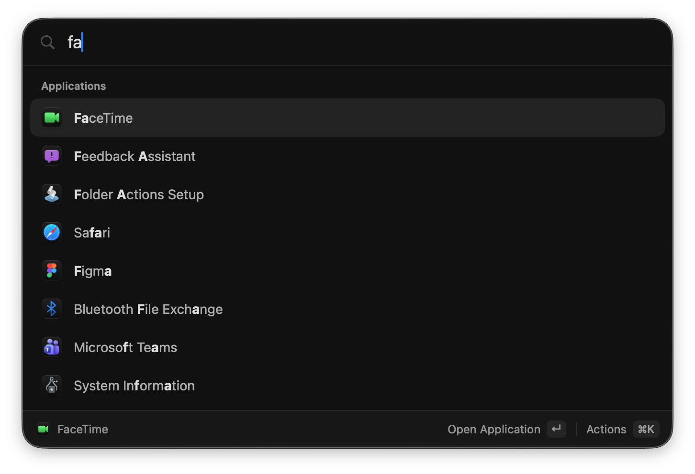
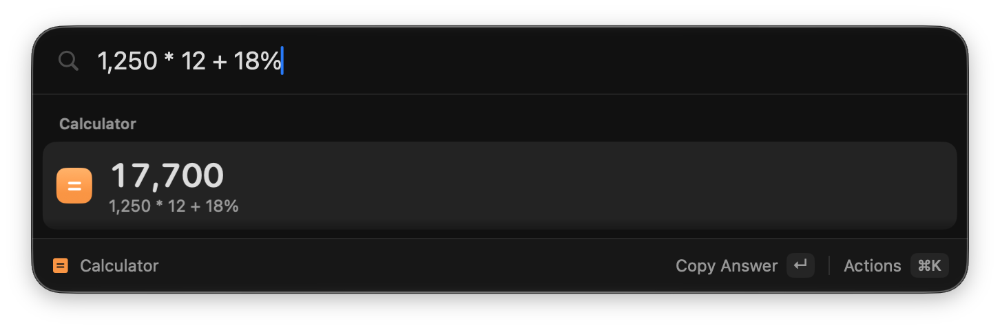
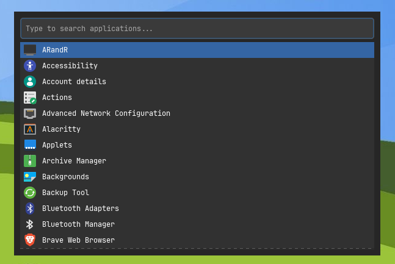

<div align="center">
  
  <h1>Pocket</h1> 
  
  **Pocket** is a lightweight, keyboard-driven application launcher for **Linux** and **macOS**.  
  On Linux it's a small **C++/GTK** app for X11 window managers; on macOS it's a native **Swift** app with a Liquid Glass UI, built to replace Spotlight for launching apps.
</div>

---

## Screenshots

### macOS

<div align="center">
  
  <br />
  
</div>

### Linux

<div align="center">
  
</div>

## Repository layout

```
pocket/
├── linux/      C++ / GTK3 launcher for X11 window managers
├── macos/      Swift / AppKit + SwiftUI launcher (Swift Package)
└── assets/     Logo and screenshots
```

Both versions read the same config file, `~/.config/pocket/pocketrc`.

---

## macOS

### Features

- Global hotkey (default **⌘ Space**) that opens Pocket over whatever you're doing, without stealing focus from the current app
- **Glass UI**: Liquid Glass on macOS 26+, with a vibrancy blur fallback on older systems. `blur` and `solid` styles are available too.
- Fuzzy search that understands prefixes, words ("code" → Visual Studio Code), initials ("vsc"), and loose subsequences
- Learns which apps you open most and ranks them higher; recently used apps show first when the search box is empty
- **Calculator**: type `12*(3+4)`, `200 + 10%`, `sqrt(2)` or `2^10` and the answer shows up as you type; `↵` copies it
- Highlights the letters that matched, marks apps that are already running, and offers a web search when nothing matches
- **Actions menu** (`⌘K`) for the selected result: Show in Finder, Copy Path, Hide or Quit a running app
- Menu bar icon with Edit Config, Reload Config, and Launch at Login
- No Dock icon, and no Accessibility permission needed

### Requirements

- macOS 13 Ventura or newer (Liquid Glass needs macOS 26 and Xcode 26+ to build)
- Xcode or the Xcode Command Line Tools (`xcode-select --install`)

### Build and install

```bash
./macos/build.sh
```

This builds `Pocket.app`, installs it to `/Applications`, and launches it. To build without installing, run `./macos/build.sh --no-install`. The app is written to `macos/build/Pocket.app`.

For development:

```bash
cd macos
swift build && .build/debug/Pocket --show
```

Debug builds also accept `--query "<text>"`, `--actions` and `--command` to open the panel with a search typed in, the actions menu open, or the `⌘1`–`⌘9` badges showing.

### Taking over ⌘ Space from Spotlight

Spotlight owns ⌘ Space by default, so Pocket can't register it until you free it up:

1. Open **System Settings → Keyboard → Keyboard Shortcuts… → Spotlight**
2. Untick **Show Spotlight search**
3. Choose **Reload Config** from Pocket's menu bar icon, or relaunch Pocket

If the hotkey you configure is already taken, Pocket falls back to **⌥ Space**. The menu bar menu shows which hotkey is active.

To start Pocket when you log in, choose **Launch at Login** from the menu bar icon.

### Keyboard shortcuts

| Key | Action |
| --- | --- |
| `↑` / `↓`, `⌃N` / `⌃P`, `⌃J` / `⌃K` | Move selection |
| `↵` | Open the selected app (or copy a calculation's answer) |
| `⌘K` | Show the actions for the selected result |
| `⌘↵` | Show the app in Finder |
| `⌘⇧C` | Copy the app's path (or the whole calculation, e.g. `12*(3+4) = 84`) |
| `⌘1` – `⌘9` | Open the nth result (hold `⌘` to see the numbers) |
| `esc` | Close (or close the actions menu) |

### Calculator

Anything that looks like arithmetic is evaluated as you type:

- Operators `+ - * / ^`, also `× ÷ **`, and `mod`; parentheses, with a missing `)` at the end filled in
- Percentages: `15%`, `20% of 150`, and `200 + 10%` (= 220, like a pocket calculator)
- Implicit multiplication (`2pi`, `3(4 + 1)`), `x` as times (`3 x 4`), factorial (`5!`), thousands separators (`1,500`), scientific notation (`2e3`)
- Constants `pi` / `π`, `e`, `tau`, and functions `sqrt cbrt abs sin cos tan asin acos atan sinh cosh tanh ln log log2 exp round floor ceil` (trig uses radians)

A bare number or constant (`42`, `pi`) isn't treated as a calculation, so it doesn't get in the way of searching for apps.

---

## Linux (X11)

### Dependencies

- `g++` (C++17 or newer)
- `make`
- `pkg-config`
- `libgtkmm-3.0-dev` (GTK3 C++ bindings)

```bash
sudo apt install g++ make pkg-config libgtkmm-3.0-dev
```

### Build and install

```bash
./linux/build.sh
```

This builds `pocket`, installs the binary to `/usr/local/bin`, adds an autostart entry (`~/.config/autostart/pocket.desktop`) and starts Pocket in the background. You may be prompted for your password during installation.

Then launch it from anywhere:

```bash
pocket
```

Bind `pocket` to a keyboard shortcut in your window manager or desktop environment for quick access.

Pocket stays running after its window closes, so later `pocket` calls just bring the existing window back instead of starting from scratch. `pocket --background` starts it without showing the window, which is what the autostart entry does. New or removed apps are picked up the next time the window opens. To stop it, run `pkill -x pocket`.

---

## Configuration (pocketrc)

Both versions read `~/.config/pocket/pocketrc`. On Linux, changes apply the next time the window opens. Each one ignores keys it doesn't use, so you can share one file between machines. If the file is missing or a value isn't set, Pocket falls back to sensible defaults.

On macOS, **Edit Config…** in the menu bar creates a commented template for you.

### Example `pocketrc`

```
# shared
font: JetBrains Mono
font-size: 18
accent: #7C5CFF       # highlight colour for the selected row
max-results: 60

# macOS
style: glass          # glass | blur | solid
appearance: auto      # auto | dark | light
hotkey: cmd+space     # e.g. alt+space, ctrl+shift+p
menubar-icon: true
app-dirs: ~/Dev/Apps
search-url: https://duckduckgo.com/?q=%s

# Linux
icon-theme: Papirus
width: 600
height: 400
background: rgba(40, 40, 40, 0.95)
foreground: #ffffff
```

Lines starting with `#` are comments, and so is anything after a `#` that follows a space. A colour value like `#7C5CFF` is safe because nothing comes before it.

| Key | Platform | Default | Description |
| --- | --- | --- | --- |
| `font` | both | `Monospace` (Linux), SF Pro (macOS) | Font family. On macOS the app picks the right weights from the family automatically. |
| `font-size` | both | `12` (Linux), `18` (macOS) | Search text size. On macOS the rest of the type scale is derived from it. |
| `icon-theme` | Linux | GTK default | GTK icon theme |
| `width` / `height` | Linux | `600` / `400` | Window size in pixels |
| `background` | Linux | `rgba(40, 40, 40, 0.95)` | Window colour. Any CSS colour (`#rrggbb`, `rgb()`, `rgba()`, names); alpha below 1 is translucent when a compositor is running. |
| `foreground` | Linux | `#ffffff` | Text colour. The search box and list are tinted from it, so they follow light or dark backgrounds. |
| `style` | macOS | `glass` | `glass`, `blur`, or `solid` |
| `appearance` | macOS | `auto` | Follow the system, or force `dark` / `light` |
| `hotkey` | macOS | `cmd+space` | Modifiers `cmd`, `alt`/`opt`, `ctrl`, `shift` plus a key (`space`, `a`–`z`, `0`–`9`, `f1`–`f12`, …) |
| `accent` | both | subtle grey (macOS), `#3465a4` (Linux) | Colour for the selected row |
| `menubar-icon` | macOS | `true` | Show the menu bar icon. If it's hidden, quit Pocket with `killall Pocket`. |
| `max-results` | both | `60` (macOS), unlimited (Linux) | Maximum number of search results (the empty view always lists every app) |
| `app-dirs` | macOS | none | Extra comma-separated folders to scan for `.app` bundles |
| `search-url` | macOS | Google | Web search offered when nothing matches; `%s` is replaced by the query |

## License

This project is licensed under the [**MIT License**](./LICENSE).
