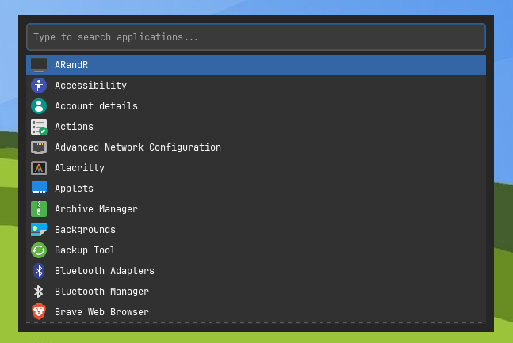

<div align="center">
  
  <h1>Pocket</h1> 
  
  **Pocket** is a lightweight, keyboard-driven application launcher for **Linux** and **macOS**.  
  On Linux it's a small **C++/GTK** app for X11 window managers; on macOS it's a native **Swift** app with a Liquid Glass UI, built to replace Spotlight for launching apps.
</div>

---

## Screenshot

<div align="center">
  
</div>

## Repository layout

```
pocket/
├── linux/      C++ / GTK3 launcher for X11 window managers
├── macos/      Swift / AppKit + SwiftUI launcher (Swift Package)
└── assets/     Logo and screenshots
```

Both versions read the same config file, `~/.config/pocket/pocketrc`.

---

## macOS

### Features

- Global hotkey (default **⌘ Space**) that opens Pocket over whatever you're doing, without stealing focus from the current app
- **Glass UI**: Liquid Glass on macOS 26+, with a vibrancy blur fallback on older systems. `blur` and `solid` styles are available too.
- Fuzzy search that understands prefixes, words ("code" → Visual Studio Code), initials ("vsc"), and loose subsequences
- Learns which apps you open most and ranks them higher; recently used apps show first when the search box is empty
- Menu bar icon with Edit Config, Reload Config, and Launch at Login
- No Dock icon, and no Accessibility permission needed

### Requirements

- macOS 13 Ventura or newer (Liquid Glass needs macOS 26 and Xcode 26+ to build)
- Xcode or the Xcode Command Line Tools (`xcode-select --install`)

### Build and install

```bash
./macos/build.sh
```

This builds `Pocket.app`, installs it to `/Applications`, and launches it. To build without installing, run `./macos/build.sh --no-install`. The app is written to `macos/build/Pocket.app`.

For development:

```bash
cd macos
swift build && .build/debug/Pocket --show
```

### Taking over ⌘ Space from Spotlight

Spotlight owns ⌘ Space by default, so Pocket can't register it until you free it up:

1. Open **System Settings → Keyboard → Keyboard Shortcuts… → Spotlight**
2. Untick **Show Spotlight search**
3. Choose **Reload Config** from Pocket's menu bar icon, or relaunch Pocket

If the hotkey you configure is already taken, Pocket falls back to **⌥ Space**. The menu bar menu shows which hotkey is active.

To start Pocket when you log in, choose **Launch at Login** from the menu bar icon.

### Keyboard shortcuts

| Key | Action |
| --- | --- |
| `↑` / `↓`, `⌃N` / `⌃P`, `⌃J` / `⌃K` | Move selection |
| `↵` | Open the selected app |
| `⌘↵` | Show the app in Finder |
| `⌘1` – `⌘9` | Open the nth result |
| `esc` | Close |

---

## Linux (X11)

### Dependencies

- `g++` (C++17 or newer)
- `make`
- `pkg-config`
- `libgtkmm-3.0-dev` (GTK3 C++ bindings)

```bash
sudo apt install g++ make pkg-config libgtkmm-3.0-dev
```

### Build and install

```bash
./linux/build.sh
```

This builds `pocket` and installs the binary to `/usr/local/bin`. You may be prompted for your password during installation.

Then launch it from anywhere:

```bash
pocket
```

Bind `pocket` to a keyboard shortcut in your window manager or desktop environment for quick access.

---

## Configuration (pocketrc)

Both versions read `~/.config/pocket/pocketrc`. Each one ignores keys it doesn't use, so you can share one file between machines. If the file is missing or a value isn't set, Pocket falls back to sensible defaults.

On macOS, **Edit Config…** in the menu bar creates a commented template for you.

### Example `pocketrc`

```
# shared
font: JetBrains Mono
font-size: 22

# macOS
style: glass          # glass | blur | solid
appearance: auto      # auto | dark | light
hotkey: cmd+space     # e.g. alt+space, ctrl+shift+p
accent: #7C5CFF       # highlight colour for the selected row
menubar-icon: true
max-results: 60
app-dirs: ~/Dev/Apps

# Linux
icon-theme: Papirus
```

| Key | Platform | Default | Description |
| --- | --- | --- | --- |
| `font` | both | `Monospace` (Linux), SF Pro (macOS) | Font family. On macOS the app picks the right weights from the family automatically. |
| `font-size` | both | `12` (Linux), `22` (macOS) | Search text size. On macOS the rest of the type scale is derived from it. |
| `icon-theme` | Linux | GTK default | GTK icon theme |
| `style` | macOS | `glass` | `glass`, `blur`, or `solid` |
| `appearance` | macOS | `auto` | Follow the system, or force `dark` / `light` |
| `hotkey` | macOS | `cmd+space` | Modifiers `cmd`, `alt`/`opt`, `ctrl`, `shift` plus a key (`space`, `a`–`z`, `0`–`9`, `f1`–`f12`, …) |
| `accent` | macOS | subtle grey | Hex colour for the selected row |
| `menubar-icon` | macOS | `true` | Show the menu bar icon. If it's hidden, quit Pocket with `killall Pocket`. |
| `max-results` | macOS | `60` | Maximum number of search results (the empty view always lists every app) |
| `app-dirs` | macOS | none | Extra comma-separated folders to scan for `.app` bundles |

## License

This project is licensed under the [**MIT License**](./LICENSE).
